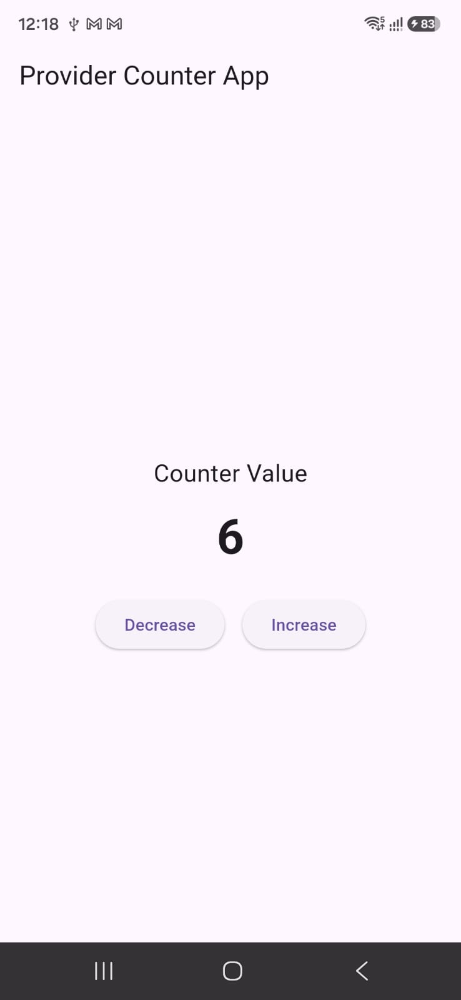

# flutter_2026_course_app

Sonic Store — a Flutter course app built while learning Flutter (Day 1 → Day 12).

## Getting Started

This project is a starting point for a Flutter application.

A few resources to get you started if this is your first Flutter project:

- [Learn Flutter](https://docs.flutter.dev/get-started/learn-flutter)
- [Write your first Flutter app](https://docs.flutter.dev/get-started/codelab)
- [Flutter learning resources](https://docs.flutter.dev/reference/learning-resources)

For help getting started with Flutter development, view the
[online documentation](https://docs.flutter.dev/), which offers tutorials,
samples, guidance on mobile development, and a full API reference.

---

## Learning Progress — All Widgets & Layouts Covered So Far

We have learned **all the core widgets and layouts** till now (Day 1 – Day 12).

### Fundamentals

- [x] Day 1 — Flutter setup on Linux, folder structure, Dart basics, `Container`
- [x] Day 2 — `Center`
- [x] Day 3 — `Text` widget
- [x] Day 4 — Buttons widgets (`ElevatedButton`, `TextButton`, `OutlinedButton`, `IconButton`)
- [x] Day 5 — `Image` widget and its types (asset, network, file, Memory)
- [x] Day 7 — `InkWell` widget

### Layout Widgets

- [x] Day 6 — `Row` widget and `Column` widget with properties
- [x] Day 8 — `ListView`, `ListView.builder` with custom `Container`, dummy data
- [x] Day 9 — `Expanded`, `CircleAvatar`
- [x] Day 10 — `Stack`, `GridView`, custom widget
- [x] Day 11 — `SizedBox`, `RichText`, `Icon` widget, Font Awesome icons (pub)
- [x] Day 12 — `ListWheelScrollView`

### UI Components

- [x] Day 9 — `Card` widget with its properties, custom fonts
- [x] Day 9 — User input & display with `TextField` + `SnackBar`
- [x] Day 9 — Date & time app (`showDatePicker` / `showTimePicker`)
- [x] Day 10 — Date picker built-in function

### Navigation & State

- [x] Day 12 — Stateless vs Stateful widget
- [x] Day 12 — Navigation page to page, splash screen with timer
- [x] Day 12 — Navigation with data transfer between pages

### Animations

- [x] Day 12 — AnimatedContainer
- [x] Day 12 — AnimatedOpacity (fade in/out)
- [x] Day 12 — AnimatedAlign

### Gradients

- [x] Day 12 — LinearGradient
- [x] Day 12 — RadialGradient
- [x] Day 12 — SweepGradient

### Data & Storage

- [x] Day 12 — List mapping
- [x] Day 12 — SharedPreferences

---

## Target UI — Sonic Store Home

Design we are tracking and building (source: `ui1.jpeg`):


### UI Breakdown Checklist

**1. App Bar / Header**

- [x] Brand title `SONIC.` + tagline `Feel every beat.`
- [x] Notification bell icon
- [x] Shopping bag icon with red count badge (`1`)

**2. Search Section**

- [x] Rounded search field with search icon — `Search earbuds...`
- [x] Filter/tune icon on the right

**3. Promo Banner (Hero Card)**

- [x] Dark rounded card with product image
- [x] `NEW COLLECTION` orange overline label
- [x] Heading `Feel The Beat.`
- [x] Orange `Shop Now` pill button

**4. Categories Section**

- [x] Section title `Categories` + `Explore` link
- [x] Horizontal filter chips — `All`, `Earbuds`, `Premium`, `Bluetooth`
- [x] Selected chip highlighted in orange

**5. Special For You Section**

- [x] Section title + product count (`2 products`)
- [x] Horizontal product cards
- [x] Card badges — `BEST SELLER`, `POPULAR`
- [x] Heart / wishlist toggle button on each card
- [x] Product image + price details

**6. Bottom Navigation Bar**

- [x] `Home` (active, orange), `Wishlist`, `Cart`, `Profile`
- [x] Cart icon with count badge

**7. Extra screens built along the way**

- [x] Product details page
- [x] Cart page with coupon code (`SONIC10`)
- [x] Wishlist page

---

## Provider Counter App

A simple counter app demonstrating **Provider** state management in Flutter.

- **Provider** (`CounterProvider`) extends `ChangeNotifier` and holds the counter state.
- `Increase` and `Decrease` buttons update the counter and call `notifyListeners()`.
- The UI rebuilds automatically via `context.watch<CounterProvider>()`.

### Files

- `lib/counter_provider.dart` — the `CounterProvider` state class.
- `lib/main.dart` — app entrypoint + `CounterPage` UI.

### Preview



### Run

```bash
flutter run
```
